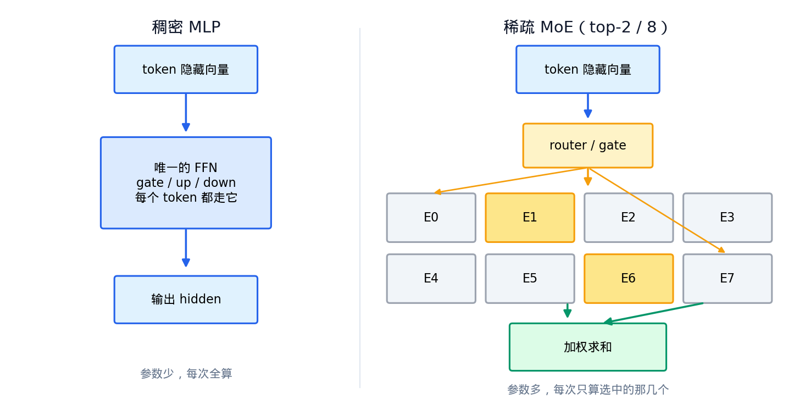
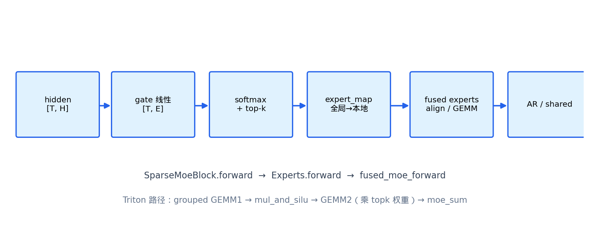
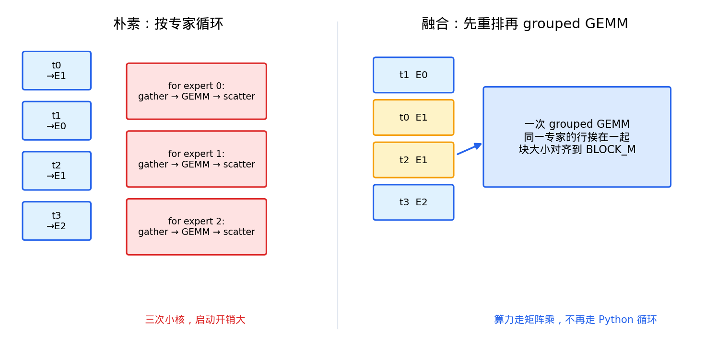
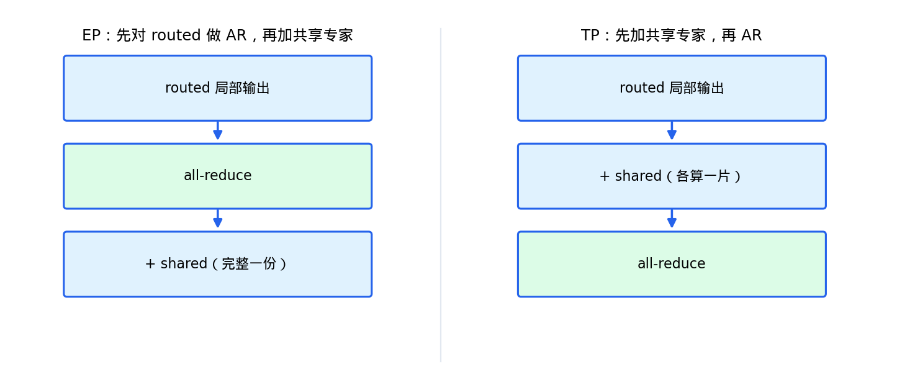

# MoE 实现

本文描述稀疏专家（Mixture of Experts）的实现：路由、grouped GEMM 融合、权重布局与加载、后端选择、共享专家与 CUDA Graph 集成。代码入口在 `src/moe/`，模型在 `src/compute/models/qwen3_moe.py`。

- [1] 概述：稠密 vs 稀疏
- [2] SparseMoeBlock 前向流程
- [3] 路由
- [4] grouped GEMM 融合
- [5] 权重布局与加载
- [6] 后端选择
- [7] 共享专家与 AR 顺序
- [8] MoE 进 CUDA Graph
- [9] 与官方 vLLM 的差异

## 1. 概述：稠密 vs 稀疏

稠密 MLP 每个 token 都要走一遍完整的 FFN；稀疏 MoE 把 FFN 换成一组专家（experts），每个 token 只激活其中 top-k 个，用门控网络（gate）决定走谁。



这让「总参数量」与「每次前向的激活计算量」解耦：模型容量可以做得很大，推理成本却只随激活专家数增长。Qwen3-MoE 采用细粒度专家（无共享专家）；Qwen1.5 / Qwen2-MoE 还带一个共享专家。

## 2. SparseMoeBlock 前向流程

`SparseMoeBlock.forward` 的链路：

```
hidden [T, H] → gate → softmax + top-k → expert_map（全局→本地）
              → fused experts（align / grouped GEMM）→ 可选共享专家 + all-reduce
```



对应的调用链：`SparseMoeBlock.forward → Experts.forward → fused_moe_forward`。层类型判定在 `qwen3_moe.py::_is_moe_layer`：

```python
if layer_idx in mlp_only_layers:
    稠密 MLP
elif (layer_idx + 1) % decoder_sparse_step == 0:
    SparseMoeBlock
else:
    稠密 MLP
```

## 3. 路由

`route_experts` 对 gate 输出做 `softmax → top-k`，可选 `norm_topk_prob`（把 top-k 权重再归一化）：

```python
scores = F.softmax(router_logits, dim=-1, dtype=torch.float32)
topk_weights, topk_ids = torch.topk(scores, top_k, dim=-1)
if norm_topk_prob:
    topk_weights = topk_weights / topk_weights.sum(dim=-1, keepdim=True)
```

gate 是 `ReplicatedLinear`（整份复制，无通信），输出 `[T, num_experts]`。

## 4. grouped GEMM 融合

朴素的专家计算按专家循环：每个专家 gather 命中自己的 token → 独立 GEMM → scatter 回写，会引发大量小 kernel 启动。融合做法是先按专家重排 token，让同一专家的行挨在一起，再跑一次 grouped GEMM。



实现上对应 `moe_align_block_size`：把展平的 `topk_ids` 按专家打包成 `sorted_ids`，块长对齐到 `BLOCK_M`，不足补 pad；每个块一个专家号，核内按容量发起、多出的块早退。


Triton 路径：`grouped GEMM1 → mul_and_silu → GEMM2（乘 topk 权重）→ moe_sum`。decode 阶段 token 数少，可跳过 align 直接算。

## 5. 权重布局与加载

运行时每层两张 3D 参数：

| 参数 | 形状 | 含义 |
|------|------|------|
| `w13_weight` | `[n_local, 2 * inter_per_tp, hidden]` | 第一层，`[up | gate]` |
| `w2_weight`  | `[n_local, hidden, inter_per_tp]`      | down |

其中 `n_local = num_experts / ep_size`，`inter_per_tp = moe_intermediate_size / tp_size`。

HuggingFace 侧常见两种存法：每专家三份 2D（`gate_proj` / `up_proj` / `down_proj`），或已叠成 3D 的 `gate_up_proj` / `down_proj`。加载器两条都收。训练侧是 `[gate|up]`（`silu(gate)*up`），本实现的 cutlass 约定是 `[up|gate]`（`up*silu(gate)`），加载时用 `_hf_gate_up_to_cutlass` 对调。


`expert_map` 是 EP 的核心数据结构：`map[全局专家号] = 本地下标`，remote 的标 `-1`，核内跳过。例如 ep=2、8 专家、rank 1 → `[-1,-1,-1,-1,0,1,2,3]`。前向里 `topk_ids` 先过 `expert_map` 再进 fused kernel。

加载结束会断言每个本地专家的 gate / up / down 都到齐，漏分片直接报错。

## 6. 后端选择

`fused_moe_forward` 分发到两个后端之一：

- **cutlass**：FlashInfer `cutlass_fused_moe`，要求 SM ∈ {89, 90, 100, 103, 110, 120, 121}（SM≥120 还需 nvcc≥12.8），`ep_size=1`（EP 已在 `expert_map` 做完）。
- **triton**：仓库内自研的 grouped GEMM 核（`src/moe/kernels/triton.py`）。

`resolve_moe_backend` 的 `auto` 策略：先探 cutlass，再探 triton，都没有则报错（没有生产用的纯 PyTorch for 循环路径）。`--moe-backend cutlass|triton` 显式指定时，不可用则立刻 `RuntimeError`，不静默降级。

辅助 CUDA 核（`align` / `mul_and_silu` / `moe_sum`）用 `torch.utils.cpp_extension.load` 从 `moe_kernels.cu` JIT 编译，可用环境变量 `VLLM_MOE_CUDA=0` 关闭。

## 7. 共享专家与 AR 顺序

带共享专家的模型（Qwen1.5 / Qwen2-MoE）在 routed 输出之上再叠加一个共享专家：

```
shared = down(SiluAndMul(gate_up(hidden))) * sigmoid(shared_expert_gate(hidden))
```

共享专家走稠密 `SiluAndMul`（`[gate|up]`），routed 走 `mul_and_silu`（`[up|gate]`），与 cutlass 约定一致。

EP 与 TP 下共享专家与 all-reduce 的先后顺序不同：



```python
if self.use_ep:
    if need_ar:
        out = tensor_model_parallel_all_reduce(out)   # EP：先对 routed 做 AR
    out = out + self._shared_expert(hidden)            #      再加完整共享专家
else:
    out = out + self._shared_expert(hidden)            # TP：先加共享（各算一片）
    if need_ar:
        out = tensor_model_parallel_all_reduce(out)     #      再 AR
```

原因：EP 下共享专家是复制的（每 rank 完整一份），若在 AR 前相加会被求和 ep 次；TP 下共享专家按中间维切分，需要先加再一起 AR。开 EP 后 MoE 自己的 `tp_size` 已折叠为 1，但 NCCL 组仍是原来那批 rank，`need_ar` 仍为真，EP 的 partial sum 靠这个组加齐。

## 8. MoE 进 CUDA Graph

MoE 默认可以开 Decode CUDA Graph。CUDA Graph 要求 capture 路径上 kernel 启动参数在 replay 时不变、capture 期间不能有每步新的不可回放分配。MoE 相对稠密多出来的难点与处理：

| 难点 | 处理 |
|------|------|
| `sorted_ids` 长度随专家负载变 | 按容量 `M·K + E·(BLOCK-1)` 固定分配，真长度写进 `num_tokens_post_pad`，核内早退 |
| 每步 `cudaMalloc` / `torch.empty` | workspace 按 `(device, shape)` 池化，align / silu / sum / GEMM 复用同一地址 |
| decode token 数每步变 | 复用稠密的 `CUDAGraphRunner`（按 BS 列表 pad） |
| Triton grid 由 Python 算 | 固定 M 时 grid 固定（按 capacity 发起，多余 block 早退） |

路由结果（`topk_ids`）每步可变不影响 Graph：变的是 buffer 内容，不是 launch 形状。验证见 `tests/gpu/test_moe_cudagraph.py`。

## 9. 与官方 vLLM 的差异

| 维度 | vLLM 官方 | 本实现 |
|------|-----------|--------|
| 覆盖模型 | 多家 MoE | Qwen2-MoE / Qwen3-MoE |
| 专家计算 | Triton + FlashInfer/CUTLASS | 同上两选一，Triton 核在仓库内 |
| EP 通信 | DeepEP / all-to-all 搬 token | remote 标 `-1`，token 不搬家，出口 all-reduce |
| EP 进程组 | 可独立 EP 组 | 复用 TP 组 |
| 量化 | FP8 / INT4 等 | 无 |
| LoRA | 有 | 无 |

专家数到 256、跨节点时官方 DeepEP 往往更合适；本实现先覆盖单机多卡、与 TP 共用 rank，语义短、好调试。代价是路由很偏时空转会比 all-to-all 明显。

尚未实现：MoE piecewise cudagraph mode、DeepEP all-to-all、量化专家权重、Mixtral / DeepSeekV3 一等接入、共享专家与 routed 融进同一条 grouped GEMM。
