# 多机多卡并行性能对比

两台机器都不具备 NVLink，卡间 P2P 也无法启用，多卡通信只能绕行主机内存。我们在这两台机器上完成了本引擎的完整评测：环境 A 是 RTX 4090 D + RTX 4070 SUPER，并与官方 vLLM 0.26.0 做了对照；环境 B 是 4 张 RTX 3090，只测本引擎。下文中的 CG 指 CUDA Graph，compile 指 `torch.compile`。

先把几条结论比较明确的观察列在这里。

- 小模型（0.6B）开启 CUDA Graph 之后，decode 能快一个数量级；模型变大，这份收益迅速变薄。`torch.compile` 主要削减 TTFT，对 decode 几乎没有帮助。
- 显存够用、卡间又没有 NVLink 时，把模型切成 TP / PP 多半更慢。只有显存不够才需要切分：环境 A 上 14B 靠不均分 PP 才塞得进 24 GB + 12 GB，环境 B 上 32B 必须 TP=4。
- 数据并行在异构双卡上会被慢卡拖死；四张同构 3090、8B 又能单卡放下时，四卡吞吐最高的是 DP=4 加 CUDA Graph，而不是 TP=4。

配图位于 `docs/figures/`，由 `gen_ieee_figs.py` 生成。原始数字集中放在文末附录，正文不再把每张表重抄一遍。

---

## 1. 两台机器

| | 环境 A | 环境 B |
| --- | --- | --- |
| 机器 | 双路 Xeon 工作站 | SYS-4029GP-TRT，双路 CPU、双 NUMA |
| 评测用 GPU | RTX 4090 D 24 GB + RTX 4070 SUPER 12 GB | 4× RTX 3090 24 GB（物理 GPU 1、2、4、5） |
| 同机未用 | — | GPU 0 是占用中的 RTX PRO 6000 Blackwell；GPU 3 是 A100 80GB，只拿来当 32B 单卡对照 |
| 同构 | 否 | 是 |
| 卡间 | 跨 NUMA，`topo -p2p r` = NS，无 NVLink | GPU1↔2、GPU4↔5 是 PIX，两对之间是 SYS；P2P 全 NS/CNS，`can_device_access_peer` 全 False，无 NVLink |
| NCCL | — | world=4：2 KB ≈ 82 µs（24 MB/s），8 KB ≈ 76 µs（104 MB/s），小消息走主机内存 |
| 精度 | bfloat16 | bfloat16 |
| 对照引擎 | 本引擎与官方 vLLM 0.26.0（V1） | 仅本引擎 |
| 模型 | Qwen3-0.6B / 4B / 8B / 14B | Qwen3-0.6B / 8B / 32B |
| 开关 | eager、CUDA Graph、`torch.compile` | eager、CUDA Graph；没开 compile |

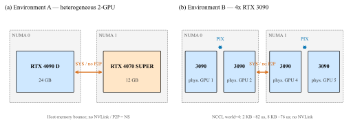

环境 A 的两张卡规格差一截：4090 D 更快、显存 24 GB，4070 SUPER 更慢、只有 12 GB。DP=2 会被 4070 拖住，12 GB 上再开 CUDA Graph 还可能 OOM。环境 B 四张卡完全同构，`CUDA_VISIBLE_DEVICES=1,2,4,5` 映射成可见卡 0–3。TP=2 走 PIX 对 `--device-ids 0,1`（物理 1+2）；TP=4 和四卡 DP 用 `0,1,2,3`。

环境 B 上 0.6B 每步大约 57 次 2 KB all-reduce，光通信大约 4.7 ms/token；8B 大约 73 次 8 KB，大约 5.5 ms。单卡 decode 要是已经比这个更快，TP 只会更慢。

---

## 2. 测试口径

基准脚本为 `bench/bench_engine.py`，官方对照为 `bench/vs_vllm.py`，整表矩阵由 `bench/run_matrix.py` 驱动。除 DP 外，prompt 都是 256 token，贪心采样，`ignore_eos`，`max_tokens=128`，bf16。本引擎侧固定 `max_num_seqs=16`、`context_len=4096`，单副本 KV 用 `num_kvcache_blocks=64`。`dp>1` 时脚本会把 KV 提到 128、`max_num_seqs` 至少 64，prompt 改成 128，一次打 32 路，看聚合吞吐。

| 指标 | 怎么算 |
| --- | --- |
| TTFT (ms) | 提交到第一个 token 的墙钟 |
| decode (tok/s) | 128 个生成 token 去掉第一个 |
| batch8 (tok/s) | 8 路一起跑，总生成 token / 墙钟 |
| DP 吞吐 (tok/s) | 32 路一起跑 |

DP 吞吐和 batch8 不是同一回事：路数 32 对 8，prompt 128 对 256。后面碰到这两个数，只看谁更大一截，不当成加速比。

每组只跑了一次。TTFT 大约有 5%–10% 的晃动；decode 和 batch 是 100 多个 token 的平均，稳一些。看结论优先看后两个。

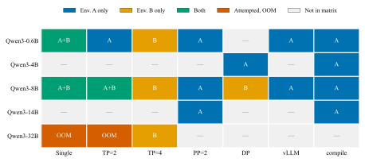

空着的格子多半是机器限制：环境 A 只有两张卡，没有 TP=4；环境 B 没测 0.6B 的 TP=2，3090 上也没开 compile。官方 V1 的离线路径已经没有 PP，所以没有 PP 对照。环境 B 没跑官方引擎。

---

## 3. 环境 A

单卡默认用 4090 D。TP=2、PP=2 是 4090 D + 4070 SUPER。

### 0.6B

0.6B 每步算得很少，时间几乎都耗在 Python 和 kernel 启动上。

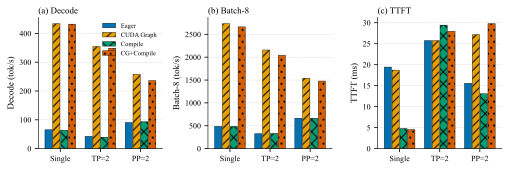

单卡 decode：eager 65.3 tok/s，CUDA Graph 433.9（6.6×）。TP=2 上这个倍率更大（8.3×），因为每步都有一堆小 all-reduce，eager 吃亏更多。PP=2 每卡层数减半，eager 自己就到了 90.5，Graph 再加成到 257.9，只有 2.8×。

compile 几乎只动 TTFT。单卡从 19.43 ms 降到 4.78 ms（4.1×），decode 还是 63.9，与 eager 的 65.3 基本持平。TP=2 的编译图里带着 all-reduce，走的是 `max-autotune`，TTFT 反而从 25.74 ms 涨到 29.43 ms。

开了 Graph 再做 TP / PP，decode 都低于单卡。eager 里 PP=2 是个例外：90.5 对单卡 65.3（1.39×），层少、启动次数也少。TP 仍然更慢。

完整数字见附录 A.1。

### 8B

8B 每步要搬大约 16 GB 权重，瓶颈在访存和算力，Graph 和 compile 的收益都没有 0.6B 那么夸张。

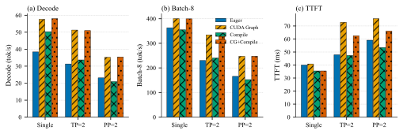

单卡 decode 38.4 → 57.6（大约 1.5×）。compile 对 TTFT 只有 1.01–1.13×。Graph 下 batch-8：单卡 400.2，TP=2 334.3（0.84×），PP=2 247.3（0.62×）。8B 能进 4090 的 24 GB，在这台机器上切成两张卡没有吞吐收益。

PP=2 纯 compile 曾经误用了 `max-autotune-no-cudagraphs`，卡过 15 分钟。改成只让 `tp>1` 走这个 mode、纯 PP 用 `reduce-overhead` 之后，大约 1 分钟就能编完。附录 B 有记录。

### Graph / compile 收益与模型大小的关系

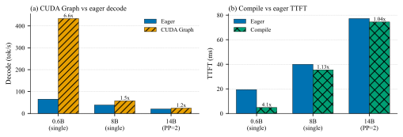

柱顶标的是倍率：Graph decode 是 6.6× / 1.5× / 1.2×，compile TTFT 是 4.1× / 1.13× / 1.04×。其中 14B 是 PP=2，不是单卡。模型越大，启动开销占比越低，这两项的相对收益就越小。

### 相对单卡的伸缩性

0.6B 用 decode 比，8B 用 batch-8 比，都是同一模式相对单卡。

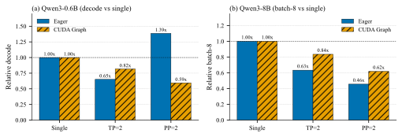

虚线是 1.0。Graph 下 TP=2、PP=2 都在线下。明显高于 1 的只有 0.6B eager 的 PP=2（1.39×）。

### 14B 与 4B 的 DP

14B 单卡放不下。用的是 `--pp-layer-counts 12,28 --device-ids 1,0`：12 层给 4070，28 层给 4090。按 20/20 均分会把 4070 打爆。

4B 的 DP=1 就是单卡 4090；DP=2 是 4090 + 4070，请求 round-robin，看 32 路聚合。

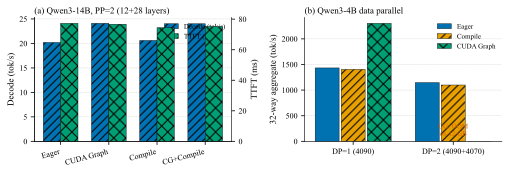

14B 上 Graph 大约 1.2×，compile 大约 1.04×。4B 的 DP=2 比 DP=1 慢（eager 1146.7 对 1432.8）：慢卡卡住了 round-robin，两份权重和 KV 还各占一份显存。DP=2 再开 Graph 会在 4070 上 OOM——模型和 CUDA 上下文大约 10.8 GB，再加按 `max_num_seqs` 捕获的图，12 GB 不够。

### 与官方 vLLM 的对照

只在环境 A 上对了 0.6B、8B 的单卡和 TP=2。

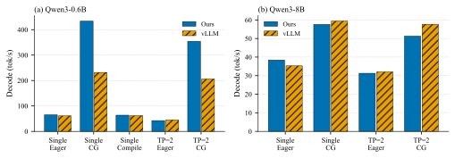

0.6B 开 Graph：本引擎单卡 decode 433.9，官方 231.8；batch-8 是 2734.4 对 1335.9。eager 下两边差不多。8B 的 decode / batch 差几个百分点。compile 不是同一件事：本引擎只编 prefill，官方的 `VLLM_COMPILE` 是全模型。0.6B 单卡 TTFT，本引擎 compile 到 4.78 ms，官方还在 23 ms 左右。8B compile TTFT：单卡 35.47 对 38.56，TP=2 47.33 对 51.36。

对照的边界写在附录 B，TTFT、batch-8 的完整表在 A.5、A.6。

---

## 4. 环境 B：4 张 3090

### 张量并行

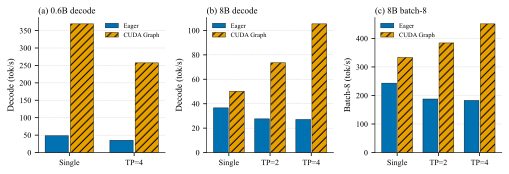

0.6B 没测 TP=2。单卡 Graph decode 369.2 tok/s，大约 2.7 ms/token，已经低于前面说的 4.7 ms 通信下限。TP=4 不管 eager（0.73×）还是 Graph（0.70×）都更慢。Graph 的 batch-8 从 2311.7 掉到 1201.0。这个尺寸不要做 TP。

8B 在 eager 里 TP 也是负的（TP=2 / TP=4 的 decode 分别是 0.75× / 0.74×）。Graph 把 all-reduce 的 launch 收进图里，每卡权重又变成 1/TP，decode 才上去：50.2 → 73.5（1.46×）→ 105.4（2.10×）。Graph 相对 eager 的 decode 倍率：单卡 1.37×，TP=2 2.66×，TP=4 3.89×。

TTFT 则一路更差。单卡 Graph 69.01 ms，TP=2 95.59，TP=4 86.59。prefill 256 token 时，单条 all-reduce 已经是 MB 量级，次数乘延迟盖过了 GEMM 的收益。batch-8 开 Graph 是 333.2 → 384.1 → 451.0，相对单卡最多 1.35×，离 4 倍还远。

### 8B 在四张卡上怎么切

8B 单卡放得下。下面三个布局都占满 4 张卡，切法和 KV 大小见 A.9。32 路 round-robin：DP=4 每副本大约 8 路，另外两个每副本大约 16 路。六组都没 OOM。

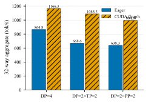

32 路、一共 4096 个生成 token。DP=4 + Graph 是 1166.3 tok/s，DP=2×TP=2 是 1088.5，DP=2×PP=2 是 994.9。

这个数和上一节 TP=4 Graph 的 batch-8（451.0）不是同一指标，但量级差得很明显。在这台机器上，8B 要用满四卡，复制四份比切成一份划得来——混合布局的副本里还要做 all-reduce 或 PP 传输，副本数又少一半，所以都没超过纯 DP。DP×TP 开 Graph 之后比较接近（0.93×），因为 8B 的 TP+Graph 本身已经转正；DP×PP 最慢（0.85×），和环境 A 上 PP 表现最差正好对上。

如果模型单卡放不下，只能先 TP / PP 切开再复制，才会用到混合布局。8B 用不上。

### 32B

3090 上 TP=1、TP=2 的 eager 都会 OOM（权重大约 62 GB；TP=2 每卡还大约 31 GB）。CG 没跑，因为 eager 已经装不进去了。只能用 TP=4。开 Graph 之后 decode 12.1 → 34.8（2.9×），batch-8 101.7 → 173.3。

单卡对照只能用同机那张空闲的 A100 80GB。HBM 和 3090 的 GDDR6X 不是一种东西，别拿来算「4 张 3090 相当于几张 A100」。

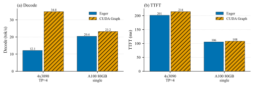

Graph decode：4×3090 TP=4 是 34.8，A100 单卡是 23.2。TTFT 仍然是 A100 更好（107.96 ms 对 214.50）。A100 上 Graph 几乎没动（20.4 → 23.2）——32B 单卡 decode 已经撞上带宽墙，瓶颈不是 launch。

---

## 5. 同一个 8B，两张单卡

两台机器都测了 8B 的单卡 eager / Graph。一张 4090 D 对一张 3090，只比较单卡快慢。

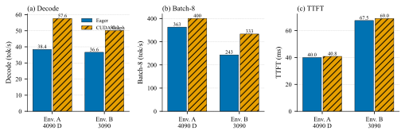

4090 D 三项都更好：Graph decode 57.6 对 50.2，batch-8 400.2 对 333.2，TTFT 40.82 ms 对 69.01 ms。0.6B 单卡 Graph 也是同一方向：decode 433.9 对 369.2，batch-8 2734.4 对 2311.7，TTFT 18.70 ms 对 24.58 ms。

哪张卡更快，推不出并行该怎么切。两台机器都没有 P2P：能单卡放下就单卡加 Graph，或者复制多份；权重大到单卡带宽成瓶颈、或者根本装不下，再上 TP 加 Graph。

---

## 6. 结论与推荐配置

环境 A：

- 0.6B 用单卡 Graph；在乎 TTFT 就再叠 compile。
- 8B 同样单卡 Graph，不要 TP / PP。
- 14B 只能走不均分 PP：`--pp-layer-counts 12,28`。
- 4B 不要 DP 到 4070 上，尤其不要在此基础上再开 Graph。

环境 B：

- 0.6B 单卡 Graph，不要 TP=4。
- 8B 四卡用 DP=4 加 Graph（32 路 1166.3 tok/s）；如果只在乎单条 decode、可以接受更差的 TTFT，TP=4 + Graph 能到 105.4 tok/s。
- 32B 只能 TP=4，装进去之后把 Graph 打开。

官方对照只在环境 A 做。0.6B 开 Graph 时本引擎明显高于官方；8B 两边接近。

后续若要补测：Graph 捕获的 batch 上限（环境 A 上 DP=2 OOM 与此相关），以及 TTFT 改成多次取中位数。

---

## 附录 A 数据

下面是这次用到的全部测量值，图按这些数画。

### A.1 环境 A，Qwen3-0.6B，本引擎

| 布局 | 模式 | TTFT (ms) | decode (tok/s) | batch8 (tok/s) |
| --- | --- | --- | --- | --- |
| 单卡 | eager | 19.43 | 65.3 | 487.3 |
| 单卡 | CG | 18.70 | 433.9 | 2734.4 |
| 单卡 | compile | 4.78 | 63.9 | 484.1 |
| 单卡 | CG+compile | 4.53 | 432.2 | 2664.6 |
| TP=2 | eager | 25.74 | 42.5 | 324.8 |
| TP=2 | CG | 25.74 | 354.4 | 2156.9 |
| TP=2 | compile | 29.43 | 39.5 | 331.4 |
| TP=2 | CG+compile | 27.96 | 348.7 | 2041.1 |
| PP=2 | eager | 15.55 | 90.5 | 664.8 |
| PP=2 | CG | 27.15 | 257.9 | 1540.5 |
| PP=2 | compile | 13.06 | 92.9 | 662.9 |
| PP=2 | CG+compile | 29.78 | 236.2 | 1477.6 |

CG decode 倍率：单卡 6.6×，TP=2 8.3×，PP=2 2.8×。CG batch-8 倍率：5.6× / 6.6× / 2.3×。compile TTFT 倍率：4.1× / 0.87× / 1.2×。

CG 相对单卡 decode：TP=2 0.82×，PP=2 0.59×。eager 相对单卡 decode：TP=2 0.65×，PP=2 1.39×。

### A.2 环境 A，Qwen3-8B，本引擎

| 布局 | 模式 | TTFT (ms) | decode (tok/s) | batch8 (tok/s) |
| --- | --- | --- | --- | --- |
| 单卡 | eager | 39.99 | 38.4 | 363.0 |
| 单卡 | CG | 40.82 | 57.6 | 400.2 |
| 单卡 | compile | 35.47 | 50.3 | 354.9 |
| 单卡 | CG+compile | 35.47 | 58.0 | 399.5 |
| TP=2 | eager | 47.88 | 31.3 | 229.9 |
| TP=2 | CG | 72.84 | 51.3 | 334.3 |
| TP=2 | compile | 47.33 | 33.7 | 240.1 |
| TP=2 | CG+compile | 62.48 | 51.0 | 333.3 |
| PP=2 | eager | 59.08 | 23.1 | 165.6 |
| PP=2 | CG | 75.63 | 35.2 | 247.3 |
| PP=2 | compile | 53.43 | 20.9 | 152.4 |
| PP=2 | CG+compile | 66.11 | 35.4 | 247.5 |

CG decode 倍率：1.5× / 1.6× / 1.5×。compile TTFT 倍率：1.13× / 1.01× / 1.11×。CG batch-8 相对单卡：TP=2 0.84×，PP=2 0.62×。

### A.3 环境 A，Qwen3-14B，PP=2 不均分

| 布局 | 模式 | TTFT (ms) | decode (tok/s) | batch8 (tok/s) |
| --- | --- | --- | --- | --- |
| PP=2 | eager | 77.26 | 20.2 | 145.8 |
| PP=2 | CG | 76.72 | 24.1 | 171.7 |
| PP=2 | compile | 74.41 | 20.6 | 147.9 |
| PP=2 | CG+compile | 75.21 | 24.0 | 171.2 |

### A.4 环境 A，Qwen3-4B，DP（32 路聚合 tok/s）

| 布局 | eager (tok/s) | compile (tok/s) | CG (tok/s) |
| --- | --- | --- | --- |
| DP=1（4090） | 1432.8 | 1403.6 | 2302.5 |
| DP=2（4090+4070） | 1146.7 | 1100.1 | OOM |

### A.5 环境 A，Qwen3-0.6B，本引擎 vs 官方 vLLM

| 布局 | 模式 | 引擎 | TTFT (ms) | decode (tok/s) | batch8 (tok/s) |
| --- | --- | --- | --- | --- | --- |
| 单卡 | eager | 本引擎 | 19.43 | 65.3 | 487.3 |
| 单卡 | eager | vLLM | 23.36 | 60.9 | 469.3 |
| 单卡 | CG | 本引擎 | 18.70 | 433.9 | 2734.4 |
| 单卡 | CG | vLLM | 23.20 | 231.8 | 1335.9 |
| 单卡 | compile | 本引擎 | 4.78 | 63.9 | 484.1 |
| 单卡 | compile | vLLM | 23.23 | 61.8 | 474.7 |
| TP=2 | eager | 本引擎 | 25.74 | 42.5 | 324.8 |
| TP=2 | eager | vLLM | 27.09 | 45.1 | 298.8 |
| TP=2 | CG | 本引擎 | 25.74 | 354.4 | 2156.9 |
| TP=2 | CG | vLLM | 24.33 | 205.9 | 1108.9 |

### A.6 环境 A，Qwen3-8B，本引擎 vs 官方 vLLM

| 布局 | 模式 | 引擎 | TTFT (ms) | decode (tok/s) | batch8 (tok/s) |
| --- | --- | --- | --- | --- | --- |
| 单卡 | eager | 本引擎 | 39.99 | 38.4 | 363.0 |
| 单卡 | eager | vLLM | 36.36 | 35.3 | 349.3 |
| 单卡 | CG | 本引擎 | 40.82 | 57.6 | 400.2 |
| 单卡 | CG | vLLM | 55.89 | 59.4 | 403.0 |
| TP=2 | eager | 本引擎 | 47.88 | 31.3 | 229.9 |
| TP=2 | eager | vLLM | 51.69 | 32.0 | 263.6 |
| TP=2 | CG | 本引擎 | 72.84 | 51.3 | 334.3 |
| TP=2 | CG | vLLM | 52.05 | 57.7 | 363.8 |

compile TTFT：单卡本引擎 35.47 对 vLLM 38.56；TP=2 本引擎 47.33 对 vLLM 51.36。

### A.7 环境 B，Qwen3-0.6B，本引擎

| 布局 | 模式 | TTFT (ms) | decode (tok/s) | batch8 (tok/s) | decode vs 单卡 |
| --- | --- | --- | --- | --- | --- |
| 单卡 | eager | 25.47 | 48.2 | 340.8 | 1.00× |
| TP=4 | eager | 33.25 | 35.2 | 251.1 | 0.73× |
| 单卡 | CG | 24.58 | 369.2 | 2311.7 | 1.00× |
| TP=4 | CG | 38.30 | 257.3 | 1201.0 | 0.70× |

### A.8 环境 B，Qwen3-8B 张量并行，本引擎

| 布局 | 模式 | TTFT (ms) | decode (tok/s) | batch8 (tok/s) | decode vs 单卡 |
| --- | --- | --- | --- | --- | --- |
| 单卡 | eager | 67.50 | 36.6 | 243.2 | 1.00× |
| TP=2 | eager | 87.17 | 27.6 | 187.7 | 0.75× |
| TP=4 | eager | 82.22 | 27.1 | 182.7 | 0.74× |
| 单卡 | CG | 69.01 | 50.2 | 333.2 | 1.00× |
| TP=2 | CG | 95.59 | 73.5 | 384.1 | 1.46× |
| TP=4 | CG | 86.59 | 105.4 | 451.0 | 2.10× |

### A.9 环境 B，Qwen3-8B 四卡切分（DP / 混合）

`CUDA_VISIBLE_DEVICES=1,2,4,5`，`--device-ids 0,1,2,3`。

| 布局 | 副本 | 每副本卡 | 卡对 | 权重 | KV（日志） |
| --- | --- | --- | --- | --- | --- |
| DP=4 | 4 | 1 | 每卡一份完整 8B | ×4 | 128 blocks × 256 tok = 4.50 GiB/副本 |
| DP=2 × TP=2 | 2 | 2 | 副本 0 → PIX 1+2；副本 1 → PIX 4+5 | ×2（每卡 1/2） | 2.25 GiB/副本 |
| DP=2 × PP=2 | 2 | 2 | 同上 PIX 对 | ×2（按层切） | 2.25 GiB/副本 |

### A.10 环境 B，Qwen3-8B，32 路聚合吞吐

| 布局 | eager (tok/s) | CG (tok/s) | CG / eager | vs DP=4 CG |
| --- | --- | --- | --- | --- |
| DP=4 | 864.8 | 1166.3 | 1.35× | 1.00× |
| DP=2 × TP=2 | 668.6 | 1088.5 | 1.63× | 0.93× |
| DP=2 × PP=2 | 638.3 | 994.9 | 1.56× | 0.85× |

### A.11 环境 B，Qwen3-32B

| 布局 | 模式 | TTFT (ms) | decode (tok/s) | batch8 (tok/s) |
| --- | --- | --- | --- | --- |
| 3090 TP=1 | eager | — | OOM | OOM |
| 3090 TP=2 | eager | — | OOM | OOM |
| 3090 TP=1 / 2 | CG | 未跑 | 未跑 | 未跑 |
| 3090 TP=4 | eager | 201.11 | 12.1 | 101.7 |
| 3090 TP=4 | CG | 214.50 | 34.8 | 173.3 |
| A100 TP=1 | eager | 105.58 | 20.4 | 132.2 |
| A100 TP=1 | CG | 107.96 | 23.2 | 143.0 |

---

## 附录 B 实现与对照边界

本引擎对官方：贪心 decode、单机，没有投机解码和多模态。KV 这边多用显式块数，官方按 `gpu_memory_utilization` 自适应；这组 batch8 都没顶到 KV。compile 不对等，见正文。官方 V1 离线路径没有 PP。所有数字都是单次测量。

PP 的 compile mode：`tp>1` 用 `max-autotune-no-cudagraphs`，单卡或纯 PP 用默认的 `reduce-overhead`。8B PP=2 的 compile 在修之前超过 15 分钟，修之后大约 1 分钟，TTFT 53.43 ms，decode 20.9，batch8 152.4。

PP 的 CUDA Graph 是 piecewise：recv/send 留在图外，图内只跑本 stage，写到静态的 `_pp_send` / `_decode_out`（vLLM #35162）。对应测试为 `test/test_parallel.py --tp 1 --pp 2`。

DP 副本用 `spawn`。副本里 `tp*pp>1` 时 `MultiprocExecutor` 还要再起 worker。Python 不允许 daemon 进程再有子进程，所以副本是 `daemon=False`，`destroy()` 里做 `join` / `terminate`。`daemon=True` 时纯 DP=4 能跑，DP 再叠 TP / PP 会直接 `AssertionError: daemonic processes are not allowed to have children`。

---

## 附录 C 配置与复现

下表是复现本文各组测量所需的配置。命令示例沿用测量阶段使用的基准脚本入口，本仓 `bench/` 下的脚本入口不同（见 `bench/README.md`），按相同入参套用即可。

| 环境 | 配置 | 关键入参 |
| --- | --- | --- |
| A | 0.6B 单卡 / TP=2 / PP=2 × eager / CG / compile / CG+compile | `--model Qwen3-0.6B --tp 1\|2 --pp 1\|2` |
| A | 8B 单卡 / TP=2 / PP=2 × eager / CG / compile / CG+compile | `--model Qwen3-8B --tp 1\|2 --pp 1\|2` |
| A | 14B 不均分 PP=2 | `--model Qwen3-14B --tp 1 --pp 2 --pp-layer-counts 12,28 --device-ids 1,0 --num-kvcache-blocks 32` |
| A | 4B DP=1 / DP=2，32 路聚合 | `--model Qwen3-4B --tp 1 --pp 1 --dp 1\|2 --n-reqs 32 --num-kvcache-blocks 48` |
| A | 官方 vLLM 对照（0.6B / 8B，单卡 / TP=2） | `--model <同上> --tp 1\|2 --cg --cuda-devices 0` |
| B | 8B TP=1 / 2 / 4 × eager / CG | `--tp 1\|2\|4 --device-ids 0 \| 0,1 \| 0,1,2,3` |
| B | 32B TP=4（3090 上仅此一种能装下） | `--model Qwen3-32B --tp 4 --device-ids 0,1,2,3` |
| B | 8B DP=4 / DP=2×TP=2 / DP=2×PP=2，32 路聚合 | `--dp 4 \| --dp 2 --tp 2 \| --dp 2 --pp 2 --n-reqs 32` |

重画本文的图（只需 matplotlib）：

```bash
python docs/figures/gen_ieee_figs.py
```

环境 B 需要先固定设备映射：

```bash
export CUDA_DEVICE_ORDER=PCI_BUS_ID
export CUDA_VISIBLE_DEVICES=1,2,4,5
export NCCL_P2P_DISABLE=1
```
