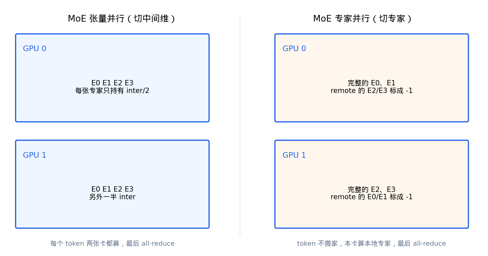

# 并行与通信

本文描述引擎的多卡并行：张量并行 TP、流水线并行 PP、数据并行 DP 与专家并行 EP，以及它们使用的通信后端。

- [1] 三种并行的正交模型
- [2] 张量并行 TP
- [3] 流水线并行 PP
- [4] 数据并行 DP
- [5] 专家并行 EP
- [6] 通信后端
- [7] 怎么选

## 1. 三种并行的正交模型

三个并行度正交，分叉点不同：

| | 切什么 | 通信 | 进程 |
|---|--------|------|------|
| **DP** | 请求 | ZMQ（本机 IPC） | 独立 Engine 副本，各有一份 Scheduler |
| **TP** | 每层权重 / head / 词表 | NCCL all-reduce / all-gather | 同 Engine，每卡一进程 |
| **PP** | 连续若干层 | NCCL send/recv hidden+residual | 同 Engine；`--pp-layer-counts` 可不均分 |

单 Engine 的 NCCL world = `tp_size × pp_size`；总 GPU ≈ `dp_size × tp_size × pp_size`。`global_rank = pp_rank * tp_size + tp_rank`。DP 不进入 NCCL world，每个副本独立一套。

`enable_ep` 不增加 world：Attention 仍走 TP，MoE 在同一批 TP rank 上按 expert 切分。

## 2. 张量并行 TP

TP 把每层权重按维切分到各 rank，通信封装在并行线性层里（`src/compute/layers/linear.py`）：

- **列并行** `ColumnParallelLinear` / `MergedColumnParallelLinear` / `QKVParallelLinear`：按输出维切分，各 rank 算局部结果，`all-gather` 拼回完整输出。用于 QKV 投影（按 head 切）、gate/up 投影。
- **行并行** `RowParallelLinear`：按输入维切分，各 rank 算局部点积后 `all-reduce` 求和。用于 o_proj / down_proj。紧跟列并行之后时设 `input_is_parallel=True`，省掉一次 all-gather。
- **词表并行** `VocabParallelEmbedding` / `ParallelLMHead`：词表按 TP 切分。greedy 路径走 `argmax`（各 rank 算局部 argmax 后归约全局最大），避免对全量 logits 做 all-gather。

GQA 下当 KV head 数小于 TP size 时，`QKVParallelLinear` 会在多个 rank 间复制 KV head（`num_kv_head_replicas`），保证每个 rank 都有完整的 KV。

## 3. 流水线并行 PP

PP 把 Transformer 层切成连续若干 stage，每个 stage 在独立 GPU 上，中间张量（hidden + residual）通过 NCCL P2P 传递：

- 首个 stage 做 embedding，末 stage 做 final norm + lm_head + 采样，中间 stage 只做本段层 + send/recv（`PPMissingLayer` 占位保持参数命名一致）。
- `pp_layer_counts`（如 `12,28`）支持不均分，适配异卡显存。
- 本实现是 **lockstep** 切层（非 1F1B）：每个 step 各 stage 依次执行自己的层区间，非末 stage 把 hidden/residual 发给下游。开 CG 时 PP 走 piecewise（recv/send 在图外，图内只做本地 forward）。

采样固定落在末 PP stage 的 tp0：`sampler_rank = (pp_size - 1) * tp_size`。

## 4. 数据并行 DP

DP 是吞吐优先的选择：起多个独立 Engine 副本（`MPClient`，`src/control/mp_client.py`），每个副本有独立的 NCCL world 与 Scheduler，请求经 ZMQ round-robin 分发。副本内仍可再叠 TP/PP。

DP 不要与 `torchrun` 混用——`run.py --dp` 用 MPClient 拉多 Engine，`run_torchrun.py` 只服务 TP×PP 的单 Engine 多机。

## 5. 专家并行 EP

MoE 有两种多卡切法：

- **MoE TP**（默认）：每个专家按中间维切分，每个 token 的所有 rank 都参与计算，最后 all-reduce。
- **EP**（`--ep`）：把专家按 rank 整份切分，每卡持有完整的一部分专家，`expert_map` 把 remote 专家标 `-1`，token 不搬家，本卡算本地专家，出口 all-reduce。

`MoEParallelConfig.from_engine` 决定布局：开 EP 且 `tp_size>1` 时，MoE 的 `tp_size` 折叠为 1、`ep_size` 设为原 tp；否则 MoE 跟引擎 TP 切中间维。EP 复用 TP 的 NCCL 组（`get_ep_group` 未开 EP 时返回 size=1 占位组），不新建进程组。

EP 的取舍：token 始终在每卡过一遍 map，路由很偏时空转会比 all-to-all 明显，但语义短、好调试，适合单机多卡。共享专家与 AR 的先后顺序在 EP/TP 下不同，详见 [moe.md](moe.md)。

## 6. 通信后端

| 后端 | 用途 | 组 |
|------|------|-----|
| **NCCL** | TP all-reduce / all-gather、PP P2P | `device_group` |
| **Gloo** | 控制面广播（execute / reset_kv / shutdown）、采样结果回传 | `cpu_group` |
| **ZMQ** | DP 副本间的请求分发与结果回传 | 每副本一对 IPC socket |

`Group` 同时持有 `device_group`（NCCL）与 `cpu_group`（Gloo），`size==1` 时不建组、通信直接返回。`set_nccl_env` 统一设 NCCL 网卡 / IB / heartbeat 等参数。

## 7. 怎么选

- 模型单卡放得下、要吞吐 → `DP + --cg`。
- 单卡放不下、同构卡 → `TP + --cg`。
- 异构显存 → 不均分 PP（`--pp-layer-counts`）。
- 无 NVLink 的小模型不要做 TP（通信会成为瓶颈）。
- MoE 且专家多 → `--ep`（复用 TP 组切专家）。

`--device-ids` 长度必须等于 `dp × tp × pp`；NCCL 不允许两 rank 共用一张卡。
